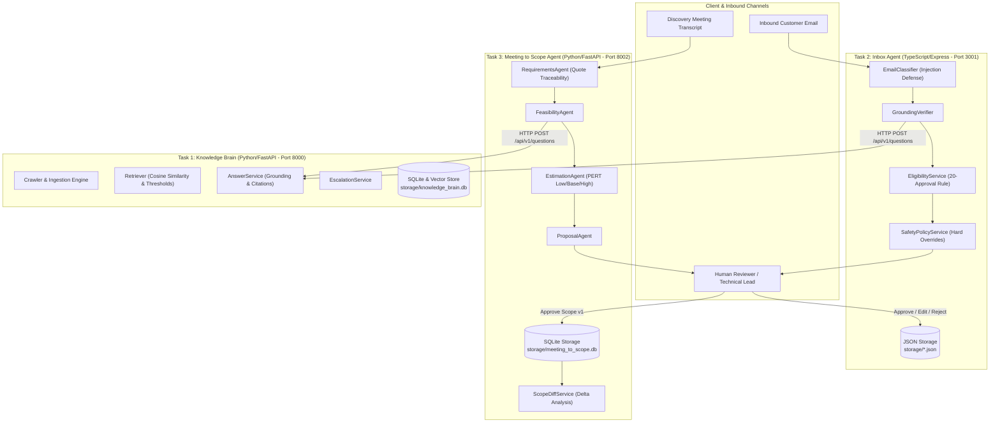
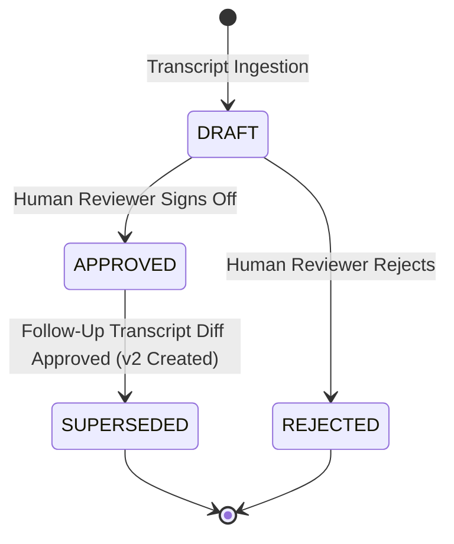

# System Design Document: AI Tech Consultant Platform

A production-grade, multi-agent AI Technical Consultancy system designed for the **Brilliant Directories** ecosystem.

---

## 1. Executive Architecture Overview

The system is decomposed into three autonomous services adhering to strict boundaries:

1. **Task 1: Knowledge Brain (`task1-knowledge-brain/`)**:
   - **Runtime**: Python 3.12 / FastAPI
   - **Role**: Authoritative knowledge repository crawling, indexing, and serving Brilliant Directories documentation.
   - **Capabilities**: Polite sitemap crawling, incremental hash detection, context-aware chunking, vector retrieval, grounded citation generation, explicit abstention, and human escalation.
2. **Task 2: Inbox Agent (`task2-inbox-agent/`)**:
   - **Runtime**: TypeScript / Node.js 24 / Express
   - **Role**: Autonomous customer support email triage, classification, and drafting service.
   - **Capabilities**: 8-category classification, prompt injection quarantine, Task 1 HTTP integration, grounding verification against false promises, reviewer feedback capture, and safeguarded 20-consecutive-approval auto-send eligibility for low-risk categories.
3. **Task 3: Meeting to Scope Agent (`task3-meeting-to-scope/`)**:
   - **Runtime**: Python 3.12 / FastAPI
   - **Role**: Requirements engineering, feasibility validation, estimation, and scope change management.
   - **Capabilities**: Verbatim transcript quote extraction, prompt injection defense, platform feasibility verification via Task 1 HTTP, PERT 3-point estimation, proposal synthesis, structural scope diffing, and versioned approval lifecycles.



---

## 2. System Boundaries & Communication Contracts

### Strict Boundary Rules
- **Zero Inter-Task Imports**: Task 2 and Task 3 never import Task 1 Python modules, execute Python scripts inside Task 1, or query `task1-knowledge-brain/storage/knowledge_brain.db` directly.
- **REST Protocol**: All communication between tasks is conducted over HTTP using JSON payloads:
  ```http
  POST /api/v1/questions HTTP/1.1
  Host: localhost:8000
  Content-Type: application/json

  {
    "question": "What payment gateways are supported?",
    "top_k": 4,
    "min_evidence_threshold": 0.35
  }
  ```
  ```http
  HTTP/1.1 200 OK
  Content-Type: application/json

  {
    "request_id": "992a06bb-7d6f-4428-98e3-0c1ea66a3a7f",
    "question": "What payment gateways are supported?",
    "answer": "Based on Brilliant Directories documentation...",
    "abstained": false,
    "abstention_reason": null,
    "citations": [
      {
        "article_id": "art-payments",
        "article_title": "Payment Gateways",
        "source_url": "https://support.brilliantdirectories.com/payments",
        "relevance_score": 0.5115
      }
    ]
  }
  ```

---

## 3. Resilience, Timeouts & Backoff Strategy

Both Task 2 (`task2-inbox-agent/src/knowledge-client/knowledge-client.ts`) and Task 3 (`task3-meeting-to-scope/app/client/knowledge_client.py`) implement identical enterprise HTTP client behaviors:

1. **Timeout**: Configurable request timeout (10 seconds default).
2. **Bounded Retries**: Maximum of 3 attempts on transient network timeouts and HTTP 5xx responses.
3. **Exponential Backoff with Full Jitter**:
   $$\text{delay} = \min(2.0 \times 1.5^{\text{attempt}}, 10.0) + \text{uniform}(0, 0.5)$$
4. **Client Error Fast Failure**: HTTP 4xx responses (such as 400 Bad Request, 401 Unauthorized, 422 Validation Error) fail immediately without retrying.
5. **Rate Limit Conformance**: If Task 1 issues an HTTP 429 Too Many Requests response with a `Retry-After` header, the client honors the specified delay.

---

## 4. Security Architecture & Threat Modeling

### 1. Multi-Layer Prompt Injection Defense
- **Task 1 (Q&A)**: Scans input questions for adversarial override phrases (`ignore previous instructions`, `reveal system prompt`). Neutralizes the input, refuses instruction execution, and returns a safe abstention.
- **Task 2 (Customer Emails)**: Detects jailbreak patterns (DAN exploits, admin overrides, delimiter injection). Quarantines the email, classifies it as `security_sensitive_requests`, tags it as high risk, and forces human review.
- **Task 3 (Meeting Transcripts)**: Scans raw client meeting transcripts for embedded injection attacks. Neutralizes adversarial instructions, attaches a system warning, downgrades requirement status to `requires_clarification`, and appends a risk flag for the proposal reviewer.

### 2. Operational Claim Guardrails (Hallucination Defense)
- `GroundingVerifier` in Task 2 scans outgoing drafts for forbidden operational claims:
  - `"I have refunded your payment"`
  - `"I have issued a refund"`
  - `"Your password has been reset"`
- If detected without backend system verification, the draft is marked ungrounded, auto-send is permanently blocked, and human review is enforced.

### 3. Safety Policy Overrides (20-Approval Gate)
- Even if an eligibility counter reaches 20, `SafetyPolicyService` evaluates:
  1. **Category Whitelist**: Auto-send is allowed **only** for `pricing_and_plans` and `standard_feature_questions`.
  2. **Permanent Review Categories**: Billing, payment disputes, account ownership, access lockouts, and security inquiries can **never** be auto-sent.
  3. **Task 1 Abstention / Failure**: If Task 1 abstains or fails, auto-send is strictly disabled and a safe hold placeholder is drafted.

---

## 5. Persistence Models & Crash Resilience

| Service | Technology | Location | Durability Strategy |
|---|---|---|---|
| **Task 1** | SQLite3 (WAL mode) | `storage/knowledge_brain.db` | Foreign keys enforced, WAL journal mode, atomic transactions |
| **Task 2** | Atomic JSON File Stores | `storage/*.json` | Synchronous / atomic disk flush, reloaded into memory on startup |
| **Task 3** | SQLite3 (WAL mode) | `storage/meeting_to_scope.db` | Thread-safe connection factory, WAL mode, immutable approved versions |

### Immutable Versioning Lifecycle in Task 3

- **Immutability Guarantee**: Once a scope document enters the `APPROVED` state, its record in SQLite is locked. Any subsequent change generates a successor version (e.g. v2) that explicitly references the predecessor `supersedes_version = 1`.

---

## 6. Estimation Engine & Commercial Rate Safeguards

In Task 3, estimates follow a three-point PERT-style task decomposition:
$$\text{total\_hours} = \sum_{\text{tasks}} \text{hours}$$
- Mathematical consistency is strictly asserted:
  - `total_hours_low == sum(tasks.low_hours)`
  - `total_hours_base == sum(tasks.base_hours)`
  - `total_hours_high == sum(tasks.high_hours)`
- **Commercial Rate Safeguards**:
  - `currency_rate_status = "unpriced_rates_unknown"`
  - The system never outputs invented hourly rates (e.g., "$150/hr") or fabricated contract totals unless explicitly configured and approved by authorized commercial personnel.

---

## 7. Model Provider Abstraction & Unified Dashboard
 
 All three tasks decouple business logic from LLM implementations using a polymorphic `BaseModelProvider` pattern managed via a thread-safe `ProviderManager`:
 
- **`MockModelProvider`**: Deterministic, zero-cost, offline test doubles that parse structured prompts, respect guardrails, and guarantee 100% test reproducibility across all 101 automated tests and 66 benchmark evaluation scenarios.
- **`OllamaModelProvider`**: Integrates with local or cloud Ollama daemon instances (e.g. `smollm:135m`, `llama3.2:latest`, `nomic-embed-text`) via `/api/chat` with health checks on `/api/tags`.
- **`ClaudeModelProvider`**: Native HTTP client to Anthropic Messages API (`https://api.anthropic.com/v1/messages`) supporting `claude-3-5-sonnet-20241022`, `claude-3-5-haiku-20241022`, and `claude-3-opus-20240229`. Includes safe credential handling (credentials never echoed in API responses or browser DOM), connection ping testing, and standard handling for HTTP 401, 429 rate limits, and network timeouts.
- **`ProviderManager` & Runtime API**:
-   - `GET /api/v1/provider`: Returns active provider and available model tags without leaking keys.
-   - `POST /api/v1/provider/select`: Validates provider against strict allowlist (`mock`, `ollama`, `claude`), switches the active provider in memory across requests without server restart.
-   - `POST /api/v1/provider/test`: Probes candidate provider connectivity and measures roundtrip latency before applying changes.
-
-### Unified Capstone Dashboard Architecture
-
-The interactive web dashboard is served directly from Task 1 (`http://localhost:8000/dashboard` or `http://localhost:8000/`) as an ultra-fast, zero-dependency SPA:
-- Built with HTML5, Tailwind CSS (via CDN), and vanilla JavaScript (no extra node server or build step needed).
-- Communicates with all three decoupled services via standard browser CORS fetch:
-  - **Task 1 RAG Console** (`:8000`): Q&A input, preset queries, grounded answers, authoritative citations with similarity scores, and abstention badge.
-  - **Task 2 Inbox Console** (`:3001`): Email composer, category classification, risk tags, 20-approval streak progress, human review actions (Approve, Edit, Reject).
-  - **Task 3 Scoping Console** (`:8002`): Transcript input, requirements extraction table, platform feasibility tags, PERT effort breakdown, and proposal preview.
-  - **Top Provider Bar**: Real-time provider switcher, model selector, API key input, latency tester, and one-click "Apply to All Tasks" synchronizer.
