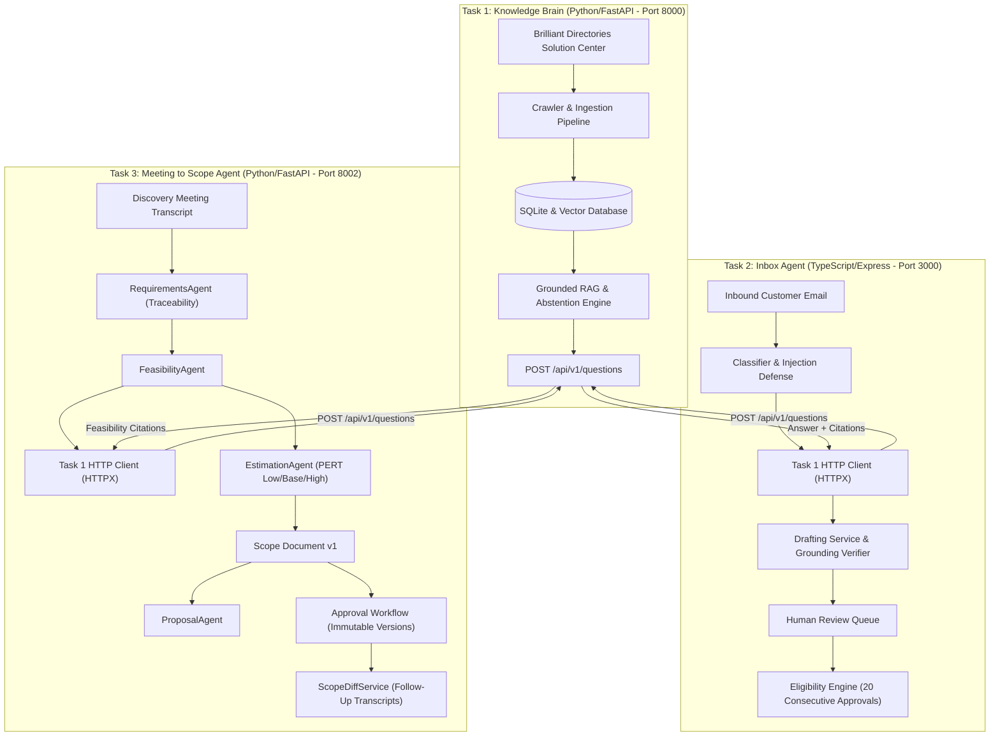

# AI Tech Consultant — Capstone System

An end-to-end, multi-agent enterprise AI technical consultancy platform built for the **Brilliant Directories** ecosystem.

This repository implements a production-grade three-tier architecture:
1. **Task 1: Knowledge Brain (`task1-knowledge-brain/`)** — Grounded RAG knowledge service indexing Brilliant Directories documentation, providing vector retrieval, strict citation verification, and automated abstention/escalation.
2. **Task 2: Inbox Agent (`task2-inbox-agent/`)** — Autonomous customer support triage and drafting service in TypeScript/Node.js with prompt injection quarantine, human-in-the-loop review, and a verified 20-consecutive-approval auto-send threshold for low-risk categories.
3. **Task 3: Meeting to Scope Agent (`task3-meeting-to-scope/`)** — Requirements engineering, feasibility validation, estimation, proposal generation, and scope change diffing agent in Python/FastAPI with immutable version control.

---

## Architecture & Integration Flow



---

## Strict Architectural Boundary Rules

- **Zero Python Cross-Imports**: Task 2 and Task 3 never import Task 1's internal modules or access `knowledge_brain.db` directly. All platform knowledge is queried strictly via Task 1's public HTTP REST API (`POST http://localhost:8000/api/v1/questions`).
- **Resilient Network Clients**: Both Task 2 and Task 3 implement bounded retries with exponential backoff and randomized jitter on network/5xx errors, non-retry on 4xx client errors, and adherence to `Retry-After`.
- **Persistent State Across Restarts**:
  - Task 1: SQLite database (`storage/knowledge_brain.db`).
  - Task 2: File-backed atomic JSON stores (`storage/emails.json`, `storage/eligibility.json`, `storage/reviews.json`).
  - Task 3: Thread-safe SQLite database (`storage/meeting_to_scope.db`).
- **Unified AI Provider Switching**: Real-time runtime switching between **Offline Mock (Zero-Cost)**, **Local Ollama** (e.g., `smollm:135m`, `llama3.2`), and **Claude AI API** (`claude-3-5-sonnet`) across all three tasks without server restart.
- **Interactive Capstone Dashboard**: Complete single-page dashboard served directly from Task 1 (`http://localhost:8000/dashboard` or `http://localhost:8000/`) featuring live provider switching, Task 1 Q&A console, Task 2 triage & 20-approval review console, and Task 3 scoping & PERT breakdown console.
- **Unpriced Commercial Terms**: Commercial hourly rates and fixed pricing remain strictly unpriced (`unpriced_rates_unknown`) requiring human sales authorization.

---

## Test & Benchmark Verification Summary

| Subsystem | Test Suite | Benchmark Evaluation | Status |
|---|---|---|---|
| **Task 1: Knowledge Brain** | 52/52 Pytest passed (0.88s) | 20/20 Scenarios passed (100%) | Verified |
| **Task 2: Inbox Agent** | 41/41 Vitest passed (0.68s) | 22/22 Scenarios passed (100%) | Verified |
| **Task 3: Meeting to Scope Agent** | 18/18 Pytest passed (0.45s) | 24/24 Scenarios passed (100%) | Verified |
| **Complete System** | **111 / 111 Tests Passed** | **66 / 66 Evaluations Passed** | **100% Pass Rate** |

---

## Interactive Web Dashboard

Launch all three services and open:
👉 **`http://localhost:8000/dashboard`** (or `http://localhost:8000/`)

### Dashboard Capabilities:
1. **Top Provider Control Bar**: Switch between Mock, Ollama, and Claude. Test connectivity latency and apply selected provider across all three tasks simultaneously.
2. **Task 1 Console**: Interactive RAG Q&A with real-time answer grounding, citation cards, similarity scores, and abstention indicators.
3. **Task 2 Console**: Inbound customer email triage, 8-category classification, prompt injection defense, 20-consecutive-approval streak tracking, and human review actions (Approve, Edit, Reject).
4. **Task 3 Console**: Discovery meeting transcript analysis, quote-traceable requirements extraction, Task 1 platform feasibility verification, PERT 3-point estimation, and proposal preview.

---

## Defense & Live Technical Review Guide

A complete, 42-question technical defense guide covering every design decision, edge case, and architectural failure mode is available at:
👉 **[`QA.md`](./QA.md)**

---

## Quick Start Commands

### 1. Task 1: Knowledge Brain & Dashboard (Port 8000)
```bash
cd task1-knowledge-brain
source .venv/bin/activate
pytest tests/ -v
python scripts/run_evaluations.py
uvicorn app.main:app --port 8000 --reload
```

### 2. Task 2: Inbox Agent (Port 3001)
```bash
cd task2-inbox-agent
npm install
npm test
npm run eval
npm run build
npm start
```

### 3. Task 3: Meeting to Scope Agent (Port 8002)
```bash
cd task3-meeting-to-scope
PYTHONPATH=. ../task1-knowledge-brain/.venv/bin/python -m pytest tests/ -v
../task1-knowledge-brain/.venv/bin/python evaluation/run_evaluation.py
PYTHONPATH=. ../task1-knowledge-brain/.venv/bin/python -m uvicorn app.main:app --port 8002 --reload
```
