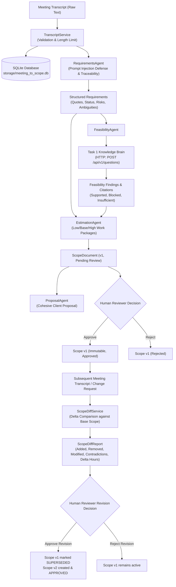

# Task 3: AI Tech Consultant — Meeting to Scope Agent

A production-grade, human-in-the-loop requirements engineering and scoping agent built with **Python 3.12**, **FastAPI**, **Pydantic v2**, and **SQLite**.

The Meeting to Scope Agent automates the conversion of discovery meeting transcripts into structured, traceable requirements, validates technical feasibility against the **Task 1 Knowledge Brain** exclusively over HTTP, generates transparent effort estimates with mathematical consistency, produces cohesive client proposals, and detects material scope changes across subsequent project meetings.

---

## 1. System Architecture & Workflow



### Architectural Highlights

1. **Strict Service Decoupling**: Task 3 communicates with Task 1 exclusively through its public HTTP API (`http://localhost:8000/api/v1/questions`). It never imports internal Python modules from Task 1 or queries its SQLite/vector database directly.
2. **Resilience & Politeness**: The dedicated `KnowledgeBrainClient` implements configurable timeouts (10s), exponential backoff with randomized jitter on transient network/5xx failures, `Retry-After` adherence, and non-retry on 4xx client errors.
3. **Traceability & Grounding**: Every requirement records the exact verbatim quotation from the meeting transcript (`source_quote`), its confidence score, and status (`confirmed`, `assumed`, `ambiguous`, `requires_clarification`).
4. **No Fabricated Pricing or Commitments**: Commercial rates and staffing are kept unpriced (`currency_rate_status = "unpriced_rates_unknown"`). The system never hallucinates hourly rates, fixed-bid totals, or contractual delivery dates.
5. **Immutable Versioning**: Approved scope documents cannot be mutated in place. New revisions create a fresh version (v2, v3, ...) that references the superseded predecessor.
6. **Persistence**: All transcripts, scope versions, diff reports, and reviewer audit trails persist to disk in SQLite (`storage/meeting_to_scope.db`) and survive server restarts.

---

## 2. Technology Stack

- **Runtime**: Python 3.12.12
- **Framework**: FastAPI (0.110+)
- **Data Validation**: Pydantic v2 (2.12+) & Pydantic-Settings
- **HTTP Client**: HTTPX (0.27+)
- **Database**: SQLite3 (Standard Library)
- **Testing**: Pytest (8.0+) & Pytest-Asyncio
- **Model Providers**: `BaseModelProvider` supporting `MockModelProvider` (deterministic, zero-cost) and `OllamaModelProvider` (local/cloud models)

---

## 3. Quick Start & Setup

### 1. Environment Setup
```bash
cd task3-meeting-to-scope
cp .env.example .env
```

### 2. Run Tests & Benchmark Evaluations
```bash
# Run unit and integration tests (11 tests in 0.4s)
PYTHONPATH=. ../task1-knowledge-brain/.venv/bin/python -m pytest tests/ -v

# Run the 24 benchmark evaluation scenarios (100% pass rate)
../task1-knowledge-brain/.venv/bin/python evaluation/run_evaluation.py
```

### 3. Start the API Server
```bash
PYTHONPATH=. ../task1-knowledge-brain/.venv/bin/python -m uvicorn app.main:app --port 8002 --reload
```

---

## 4. API Reference

### Health Check
- **`GET /health`**
  - Returns service status, active model provider, and Task 1 endpoint.

### Transcript Management
- **`POST /api/v1/transcripts`**
  - Ingests and validates meeting transcript text (10 to 50,000 characters).
  - **Payload**:
    ```json
    {
      "transcript_text": "We need a member directory where visitors can search by city and category...",
      "metadata": {
        "project_name": "Coastal Chamber Directory",
        "client_name": "Coastal Chamber",
        "meeting_date": "2026-10-18"
      }
    }
    ```
  - **Response (201 Created)**: Returns `{ "transcript_id": "tr_...", "char_count": ..., "created_at": "..." }`.

- **`GET /api/v1/transcripts/{transcript_id}`**
  - Retrieves a stored transcript by ID.

### Scope Generation & Versioning
- **`POST /api/v1/scope/generate`**
  - Executes end-to-end extraction, Task 1 feasibility evaluation, and estimation.
  - **Payload**:
    ```json
    {
      "transcript_id": "tr_1234567890",
      "project_name": "Coastal Chamber Directory",
      "client_name": "Coastal Chamber"
    }
    ```
  - **Response (201 Created)**: Returns structured `ScopeDocument` with status `"pending_review"`.

- **`GET /api/v1/scope/{scope_id}`**
  - Retrieves a saved scope document.

- **`POST /api/v1/scope/{scope_id}/approve`**
  - Human reviewer approves scope. Sets status to `"approved"`, records reviewer identity and timestamp.
  - **Payload**: `{ "action": "approve", "reviewer_name": "Senior Consultant", "reviewer_notes": "Reviewed and agreed" }`

- **`POST /api/v1/scope/{scope_id}/reject`**
  - Rejects draft scope with reviewer notes.

### Scope Change Detection & Revision Workflow
- **`POST /api/v1/scope/{scope_id}/diff`**
  - Compares a follow-up transcript or change request against an active approved scope.
  - **Payload**:
    ```json
    {
      "change_request_text": "We also want automated lead matching. Please cancel the CSV migration task."
    }
    ```
  - **Response (200 OK)**: Returns `ScopeDiffReport` categorizing each change as `added`, `removed`, `modified`, `unchanged`, or `contradiction`, along with the net effort hours delta.

- **`POST /api/v1/scope/{scope_id}/revisions/{diff_id}/approve`**
  - Approves the scope diff. The base scope is marked `"superseded"`, and a new immutable scope (`version = base.version + 1`) is created with status `"approved"`.

### Client Proposal Generation
- **`GET /api/v1/proposals/{scope_id}`**
  - Generates executive client proposal derived directly from the validated scope object, guaranteeing zero discrepancy between scope and proposal.

---

## 5. Synthetic Transcripts

The repository includes three realistic synthetic transcripts in [`transcripts/sample_transcripts/`](file:///Users/macki/Desktop/Assement/AI%20Tech%20Consultant%20-%20%20Business%20Labs%20dupe/task3-meeting-to-scope/transcripts/sample_transcripts/):

1. **`transcript_01_straightforward.txt`**: Clear discovery call for Coastal Chamber business directory with search, Google Maps, Stripe recurring billing, and legacy CSV import.
2. **`transcript_02_ambiguous.txt`**: Exploratory meeting with unconfirmed features, missing budget, and vague completion timelines ("ASAP"), demonstrating uncertainty tracking and open questions formulation.
3. **`transcript_03_scope_change.txt`**: Follow-up board strategy call introducing material changes: adding automated lead distribution, cancelling CSV import, and modifying the payment gateway.

---

## 6. Verification Evidence

### 1. Pytest Test Suite (`tests/`)
```
============================== 11 passed in 0.42s ==============================
tests/integration/test_api_endpoints.py::test_api_endpoints_workflow PASSED
tests/integration/test_scope_diff_workflow.py::test_scope_diff_and_revision_lifecycle PASSED
tests/integration/test_scope_pipeline.py::test_end_to_end_scope_pipeline PASSED
tests/unit/test_estimation_agent.py::test_estimation_arithmetic_consistency PASSED
tests/unit/test_feasibility_agent.py::test_feasibility_supported_by_evidence PASSED
tests/unit/test_feasibility_agent.py::test_feasibility_abstention PASSED
tests/unit/test_knowledge_client.py::test_knowledge_client_success PASSED
tests/unit/test_knowledge_client.py::test_knowledge_client_client_error PASSED
tests/unit/test_proposal_agent.py::test_proposal_derived_from_scope_without_contradiction PASSED
tests/unit/test_requirements_agent.py::test_extract_requirements_functional_and_integrations PASSED
tests/unit/test_requirements_agent.py::test_prompt_injection_defense PASSED
```

### 2. Benchmark Evaluation Suite (`evaluation/run_evaluation.py`)
```
==========================================================================
🧪 TASK 3: MEETING TO SCOPE AGENT BENCHMARK EVALUATIONS (24 Cases)
==========================================================================
| ID | Scenario Name | Result |
|---|---|---|
| eval_001_straightforward | Clear transcript with straightforward requirements | ✅ PASS |
| eval_002_missing_acceptance_criteria | Transcript with missing acceptance criteria | ✅ PASS |
| eval_003_contradictory_requirements | Transcript with contradictory requirements | ✅ PASS |
| eval_004_ambiguous_deadlines | Transcript with ambiguous deadlines ('ASAP') | ✅ PASS |
| eval_005_no_stated_budget | Transcript with no stated budget | ✅ PASS |
| eval_006_non_functional_requirements | Transcript containing non-functional requirements | ✅ PASS |
| eval_007_access_control_requirements | Transcript containing access-control requirements | ✅ PASS |
| eval_008_supported_by_task1_evidence | Requirement supported by Task 1 evidence | ✅ PASS |
| eval_009_insufficient_task1_evidence | Requirement with insufficient Task 1 evidence | ✅ PASS |
| eval_010_task1_timeout | Task 1 timeout handling | ✅ PASS |
| eval_011_task1_server_error_500 | Task 1 HTTP 500 server error handling | ✅ PASS |
| eval_012_malformed_task1_response | Malformed Task 1 response handling | ✅ PASS |
| eval_013_unsupported_platform_capability | Unsupported platform capability (Native iOS App) | ✅ PASS |
| eval_014_estimates_unknown_commercial_rates | Estimates with unknown commercial rates | ✅ PASS |
| eval_015_estimate_arithmetic_consistency | Estimate subtotal and total mathematical consistency | ✅ PASS |
| eval_016_scope_generation_unresolved_assumptions | Scope generation with unresolved assumptions | ✅ PASS |
| eval_017_added_requirement_subsequent_transcript | Added requirement in subsequent transcript | ✅ PASS |
| eval_018_modified_requirement_subsequent_transcript | Modified requirement in subsequent transcript | ✅ PASS |
| eval_019_removed_requirement_subsequent_transcript | Removed or explicitly cancelled requirement | ✅ PASS |
| eval_020_contradiction_between_new_and_approved_scope | Contradiction between new request and approved scope | ✅ PASS |
| eval_021_scope_change_requires_human_approval | Scope change that requires human approval | ✅ PASS |
| eval_022_rejection_of_scope_change | Rejection of a proposed scope change | ✅ PASS |
| eval_023_approval_creates_immutable_new_version | Approval creating an immutable new version | ✅ PASS |
| eval_024_prompt_injection_in_transcript | Prompt injection embedded in meeting transcript | ✅ PASS |
==========================================================================
EVALUATION SUMMARY: 24/24 PASSED (100%)
==========================================================================
```

---

## 7. Model Deviation & Claude Requirement Disclosure

> **Honest Compliance Statement**: The capstone specification mentions Claude as a potential reference model. Due to strict budget constraints and the need for repeatable offline test execution, Task 3 was implemented using an extensible provider interface (`BaseModelProvider`). By default, it operates with `MockModelProvider` for deterministic, zero-cost evaluation, and includes `OllamaModelProvider` targeting local/cloud models (such as `llama3.2`). Claude is not directly invoked. An Anthropic Claude adapter can be added without altering the service layer, database schemas, or routing logic.

---

## 8. Live Project Demonstration Script (5-Minute Walkthrough)

1. **Start Task 3 Server**:
   ```bash
   PYTHONPATH=. ../task1-knowledge-brain/.venv/bin/python -m uvicorn app.main:app --port 8002
   ```
2. **Submit Baseline Transcript**:
   Post `transcripts/sample_transcripts/transcript_01_straightforward.txt` to `POST /api/v1/transcripts`.
3. **Generate Scope**:
   Call `POST /api/v1/scope/generate` with the `transcript_id`. Observe extracted requirements, Task 1 feasibility citations, and estimated effort packages.
4. **Approve Baseline Scope**:
   Call `POST /api/v1/scope/{scope_id}/approve` with reviewer name. The scope transitions to `approved` (version 1).
5. **Submit Scope Change**:
   Call `POST /api/v1/scope/{scope_id}/diff` with `transcripts/sample_transcripts/transcript_03_scope_change.txt`. Review the structured delta report showing added lead matching, removed CSV migration, and net hour impact.
6. **Approve Revision**:
   Call `POST /api/v1/scope/{scope_id}/revisions/{diff_id}/approve`. Observe that Scope v1 is preserved as `superseded` and Scope v2 is created as the new active approved version.
